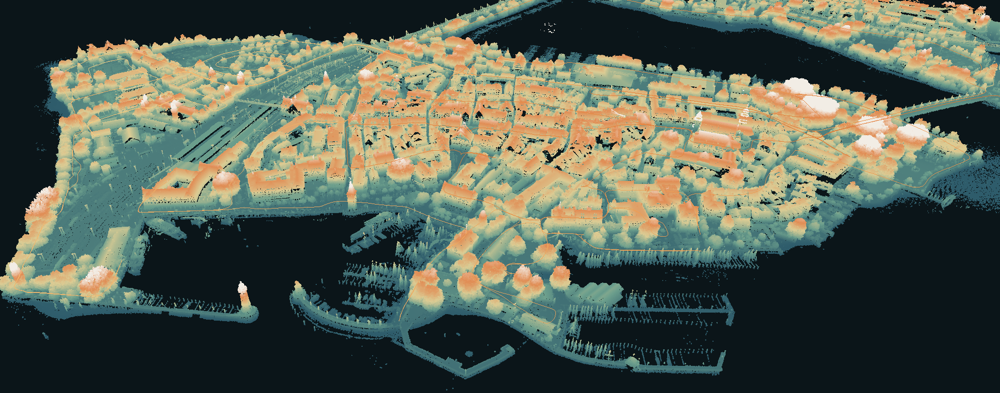

# Inselkarte Lindau

Eine begehbare 3D-Punktwolke der Lindauer Insel direkt im Browser – Straßen, Fassaden, Hafen und
Seebrücke, eingefärbt mit echten Kamerafarben.

https://kryptomane.github.io/Lindau-Island/

## Entstehung

Mit einem Messfahrzeug, ausgerüstet mit diversen Sensoren (Laserscanner auf dem Dach, Kameras
rundum, Satellitenortung), wurden 2022 die Daten aufgezeichnet – im Rahmen einer
Sondergenehmigung der Stadt Lindau.

## Arbeitsschritte

1. **Aufzeichnung und Synchronisierung** – alle Sensoren laufen auf einer gemeinsamen Uhr,
   millisekundengenau (PTP, IEEE 1588).
2. **Kalibrierung** – jede Kamera wird vermessen und ihre genaue Lage am Fahrzeug bestimmt,
   subpixelgenau (intrinsische + extrinsische Kalibrierung).
3. **SLAM** – aus den Laserscans entsteht gleichzeitig die Karte und die gefahrene Strecke
   (LiDAR-SLAM):
   - Scans werden Stück für Stück aneinandergesetzt (LiDAR-Odometrie, ICP).
   - Stellen, an denen das Fahrzeug schon einmal war, werden wiedererkannt und die Strecke
     daran ausgerichtet (Loop Closure, Scan Context; Pose-Graph-Optimierung mit GNSS).
   - Autos, Fußgänger und andere bewegte Objekte werden entfernt.
   - Jeder Punkt bekommt seine Farbe aus den Kamerabildern (Projektion LiDAR → Kamera).
4. **Fusion** – was von der Straße aus nicht zu sehen ist – Dächer, Innenhöfe, Bäume – wird aus
   der amtlichen Befliegung der Bayerischen Vermessungsverwaltung ergänzt und alles auf deren
   Lage und Höhe eingepasst (ICP, ETRS89/UTM32, m ü. NHN).

## Bedienung

- **Maus/Finger:** ziehen = drehen, Mausrad bzw. zwei Finger = zoomen und verschieben;
  der Kompass richtet die Ansicht nach Norden aus.
- **Foto / Höhe / Quelle:** Einfärbung nach Kamerafarbe, nach Höhe oder nach Herkunft
  (Messfahrt bzw. Befliegung).
- **Dächer / Fahrt:** blendet die ergänzten Befliegungsdaten bzw. die Fahrtspur ein und aus.
- **− / +:** Punkte kleiner oder größer darstellen.
- **Von oben / Schräg:** feste Blickwinkel.
- **Lineal:** zwei Punkte anklicken – angezeigt werden Strecke, waagrechter Abstand,
  Höhenunterschied und die Höhen über NHN. Beenden mit ✕ oder Esc.
- **Stufe:** Handys laden automatisch eine leichtere Version (9,8 Mio. Punkte), sonst die
  volle (49,6 Mio. Punkte).

---

©Silas Maile - M.Sc. Mathematik
Dächer, Höfe, Bäume von Bayerischer Vermessungsverwaltung (CC BY 4.0) – www.geodaten.bayern.de
